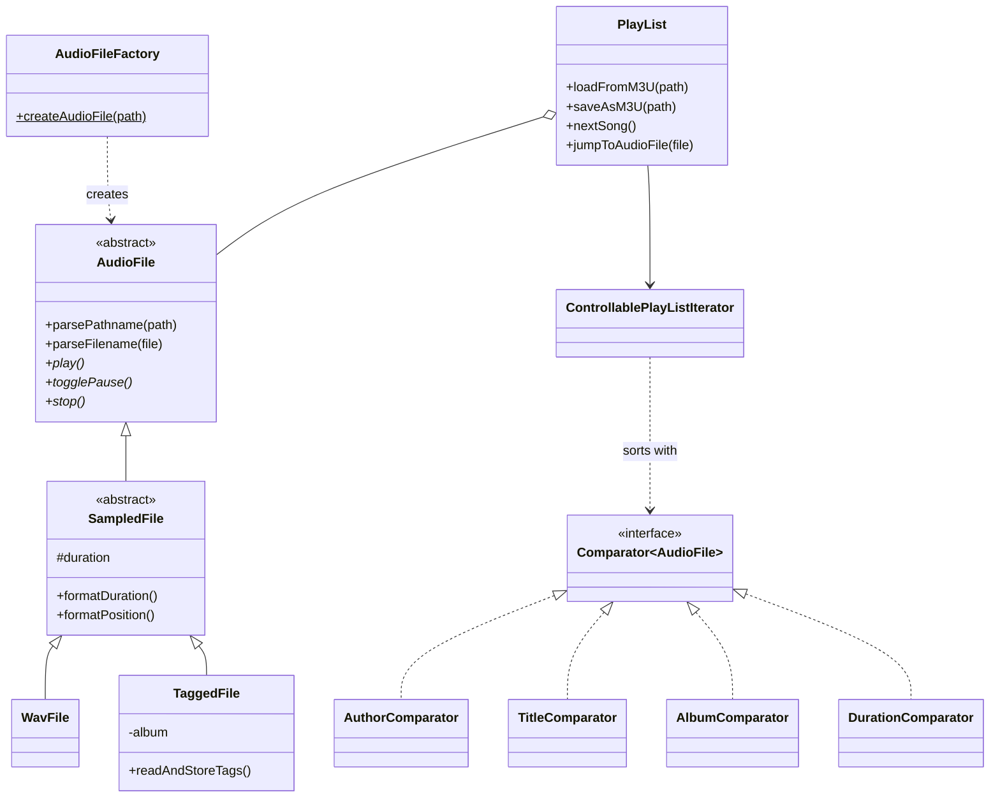

# 🎵 StudiPlayer: Cross-Platform Desktop Audio Player

A fully featured desktop audio player written in **Java 17** with a **JavaFX** GUI. It plays WAV, MP3 and OGG files, reads song metadata, manages M3U playlists and lets users search, sort and navigate their music library in real time.

The project was built at Technische Hochschule Ingolstadt. Its focus is **clean object-oriented design**: a layered architecture, classic design patterns and thread-safe UI updates.


<!-- Add a screenshot: save it as docs/screenshot.png and uncomment the line below -->
<!--  -->

---

## ✨ Features

**Playback**
- Play, pause/resume, stop and skip with **state-aware controls**: buttons enable and disable themselves depending on the player state
- **Automatic advance** to the next track, wrapping around at the end of the playlist
- **Live playback timer** (`mm:ss`), refreshed every 100 ms
- Click any row in the song table to jump straight to that track

**Library & playlists**
- Supports **WAV**, **MP3** and **OGG** files
- Reads **ID3-style metadata** (artist, title, album, duration) from tagged files
- Computes **WAV durations** from frame count and frame rate
- Falls back to **filename parsing** (`Artist - Title.mp3`) when no tags are available
- **Load and save M3U playlists**; comment lines are ignored and unplayable files are skipped without crashing the app

**Search & sort**
- **Full-text search** across artist, title and album
- **Sort** by artist, title, album or duration through interchangeable comparators

**Cross-platform**
- A custom **path normalisation engine** resolves OS-specific path syntax: it converts `/` and `\`, collapses duplicate separators and maps Windows drive letters on Unix systems, so the same playlist works on every OS

---

## 🏗️ Architecture

The code is split into two clearly separated layers:

| Package | Responsibility |
|---|---|
| `studiplayer.audio` | Domain model: audio file types, metadata, playlists, iteration, sorting, error handling |
| `studiplayer.ui` | JavaFX presentation layer: main window, song table, controls, background threads |



### Design decisions

- **Inheritance & polymorphism:** `AudioFile → SampledFile → WavFile / TaggedFile`. The UI only ever talks to the abstract `AudioFile` API, so it never needs to know which format is playing.
- **Factory pattern:** `AudioFileFactory` picks the right subclass from the file extension, which keeps object creation in one place.
- **Strategy pattern:** sorting is done with pluggable `Comparator` implementations selected by a `SortCriterion` enum. The comparators are *type-aware*: untagged files are ordered consistently against tagged ones.
- **Iterator pattern:** `PlayList` implements `Iterable<AudioFile>` with a custom `ControllablePlayListIterator`. The iterator applies search filtering and sorting on the fly and supports jumping to a specific track.
- **Robust error handling:** a checked `NotPlayableException` carries the failing file path, so broken or unreadable files are reported and skipped instead of crashing the player.
- **Concurrency:** playback runs on a dedicated `PlayerThread` (audio playback blocks) and the timer on a separate `TimerThread`. All UI updates are marshalled back to the JavaFX Application Thread with `Platform.runLater()`, so the interface stays responsive and thread-safe.

---

## 📁 Project structure

```
.
├── pom.xml
├── lib/                          # course audio backend (studiplayer-basic.jar, see below)
├── playlists/
│   └── DefaultPlayList.m3u       # playlist loaded on startup
└── src/main/
    ├── java/studiplayer/
    │   ├── audio/                # domain model
    │   │   ├── AudioFile.java
    │   │   ├── SampledFile.java
    │   │   ├── WavFile.java
    │   │   ├── TaggedFile.java
    │   │   ├── AudioFileFactory.java
    │   │   ├── PlayList.java
    │   │   ├── ControllablePlayListIterator.java
    │   │   ├── SortCriterion.java
    │   │   ├── *Comparator.java
    │   │   └── NotPlayableException.java
    │   └── ui/                   # JavaFX GUI
    │       ├── Player.java
    │       ├── SongTable.java
    │       └── Song.java
    └── resources/icons/          # play.jpg, pause.jpg, stop.jpg, next.jpg
```

---

## 🚀 Getting started

### Prerequisites
- JDK 17 or newer
- Maven 3.8+

### Setup
1. **Audio backend:** low-level decoding and audio output come from the course library `studiplayer.basic` (`BasicPlayer`, `TagReader`, `WavParamReader`). It is not redistributed here. Place it at `lib/studiplayer-basic.jar`.
2. **Icons:** put `play.jpg`, `pause.jpg`, `stop.jpg` and `next.jpg` into `src/main/resources/icons/`.
3. **Music:** add the paths of your audio files to `playlists/DefaultPlayList.m3u`, one per line.

### Run
```bash
mvn clean javafx:run
```

---

## 🧠 What I learned
- Designing a **class hierarchy** that stays extensible: a new format only needs a new subclass and one line in the factory
- Applying **design patterns** (Factory, Strategy, Iterator) where they solve a real problem
- **Multithreading in GUI applications**: keeping blocking work off the UI thread and synchronising updates safely
- Writing **defensive, cross-platform code** for file paths and malformed input

---

## 👤 Author

**Furkan Samli**, B.Sc. Computer Science & Artificial Intelligence, Technische Hochschule Ingolstadt
[LinkedIn](https://linkedin.com/in/furkansamli) · [GitHub](https://github.com/FurkanSamli)
